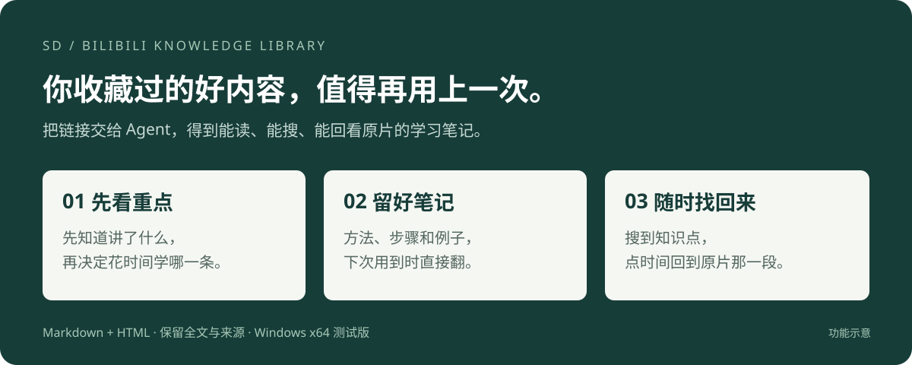
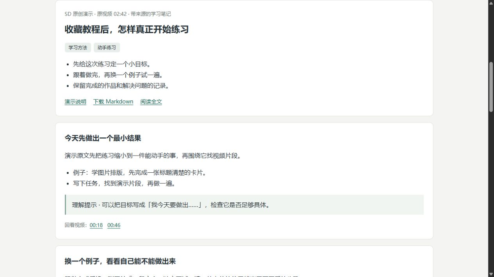

# SD · B 站收藏知识库

### 收藏的时候想着「以后一定看」，后来连收藏过什么都忘了。

教程、访谈、公开课，遇到有用的就先收藏。等真正要用时，记得某个博主讲过，却想不起是哪条视频，更想不起在第几分钟。

**把收藏夹链接发给 Agent，让它帮你整理成一份能读、能搜、能回看原片的知识库。**

`sd-bilibili-knowledge-library` 是 SD 制作的一个 Agent Skill。它会提炼视频里的知识点，保留全文文字和来源时间，同时生成 Markdown 笔记与 HTML 阅读页。



[快速开始](#快速开始) · [看看整理结果](#你最后拿到什么) · [下载 Skill ZIP](https://github.com/Allensen/sd-bilibili-knowledge-library-/raw/refs/heads/main/downloads/sd-bilibili-knowledge-library-0.2.1.zip) · [使用范围](#当前版本适合什么环境)

> 当前版本 **v0.2.1 · Windows x64 测试版**。通过支持本地文件、命令执行和联网的 Agent 使用；安装与实际流程已在 Windows x64 上验证。无需独立显卡，低配电脑的处理速度尚未实测。

## 最值得用它的三个理由

### 1. 收藏看不完，先帮你把重点拎出来

有些视频你只是想知道讲了什么，有些才值得坐下来认真学。

它会先把视频能解决的问题、主要方法和关键步骤整理出来。你可以先读要点，再决定要不要深入看，给真正感兴趣的内容留时间。

### 2. 看完容易忘，方法和例子帮你留着

当时听懂了，隔两周要用，又得从头找。

它会把作者讲的方法、步骤、例子和适用条件写进笔记，连全文转写一起保留。以后用到这个知识点，可以直接翻出来；教程里的操作顺序也有地方可查。

### 3. 想用的时候找不到，搜一下就能接着学

记不住视频标题没关系，试着搜你记得的词，比如「遮罩」「提问」「复盘」。

阅读页会在知识点和原文里找相关内容。需要听作者怎么说，点知识点下面的时间，就能跳回原视频对应位置。

## 你最后拿到什么

每次整理会生成一个保存在电脑上的知识库文件夹。

| 你想做的事 | 对应交付 |
| --- | --- |
| 先快速了解收藏里都讲了什么 | HTML 首页的视频目录、主题标签和要点 |
| 跟着作者的方法学习 | 按问题组织的知识点、步骤、例子和必要画面 |
| 确认一句话有没有被整理错 | 知识点引用的原文片段与视频时间链接 |
| 找回当时听过的一段话 | 可展开的全文转写，支持本地关键词搜索 |
| 放进自己的笔记系统 | 每条视频一份 Markdown，图片使用相对路径 |
| 以后接着补 | 来源文件、处理状态和可复用的转写缓存 |

### 整理后的笔记，大致这样读



下面是**原创演示内容**，展示阅读结构，不对应真实视频或识别效果测评。

> **收藏教程后，怎样真正开始练习**
>
> 先读要点：给每次练习定一个小目标；遇到问题再回到相关片段；把踩过的坑写进自己的步骤里。
>
> **今天先做出一个最小结果**
>
> 演示原文建议：看完目录后，先选一个能动手的小任务。例如学习图片排版，今天只完成一张标题清楚的卡片。
>
> - 写下这次要完成的东西。
> - 找到与它有关的演示片段。
> - 做一遍，把卡住的地方记下来。
>
> 理解提示（整理归纳）：可以把目标写成「我今天要做出……」，检查它是否足够具体。
>
> 回看视频：`00:18` · `00:46`
>
> 下方还可以展开对应的全文文字。

下载仓库后，直接打开 [docs/demo/index.html](docs/demo/index.html)，就能试用同一阅读模板的**关键词搜索、知识卡片和全文展开**。演示中的时间按钮定位演示原文；真实生成的知识库会链接到 B 站原视频及对应分 P。

HTML 的文字和搜索可离线使用；回看 B 站视频需要联网。保存或搬走知识库时，请带走整个文件夹，保留相对路径对应的图片与 Markdown。

## 快速开始

### 第一步：把这句话发给你的 Agent

```text
请帮我安装这个 Skill：
https://github.com/Allensen/sd-bilibili-knowledge-library-

读取仓库根目录的 SKILL.md，把完整 Skill 安装到你支持的技能目录，
目录名保留为 sd-bilibili-knowledge-library。
检查当前环境是否支持；需要初始化依赖时由你执行，不让我选择模型或配置显卡。
```

使用前提：Agent 能读取 Skill、操作本地文件、运行 PowerShell 命令，并访问所需下载源。具体工具权限由你使用的 Agent 管理，必要时仍会出现授权提示。

安装后，如果 Agent 没有发现新技能，刷新技能列表或重启它，再尝试下面的任务。

<details>
<summary>想自己放文件：手动安装方式</summary>

下载 [v0.2.1 Skill ZIP](https://github.com/Allensen/sd-bilibili-knowledge-library-/raw/refs/heads/main/downloads/sd-bilibili-knowledge-library-0.2.1.zip)，解压后得到 `sd-bilibili-knowledge-library` 文件夹，将它放到 Agent 的技能目录中。不要多套一层同名目录。可用[校验文件](downloads/SHA256SUMS.txt)检查下载完整性。

以当前 Codex 本地技能目录为例：

```text
%USERPROFILE%\.codex\skills\sd-bilibili-knowledge-library\
├── SKILL.md
├── agents\
├── assets\
├── references\
└── scripts\
```

使用其他 Agent 时，让它确认自身的 Skill 安装目录及命令权限。当前实际验收宿主为 Codex；其他 Agent 尚未逐一验证。

</details>

### 第二步：发一个收藏夹或视频链接

```text
使用 $sd-bilibili-knowledge-library，帮我整理这个 B 站收藏夹：
【粘贴你的收藏夹链接】

生成可以直接阅读的 HTML 知识库和 Markdown 笔记。
保留完整转写，每个知识点带回看时间。
只处理收藏夹里的条目，完成后打开阅读入口。
```

也可以先用一条视频试一试：

```text
使用 $sd-bilibili-knowledge-library 整理这个视频：【视频链接】。
把作者讲的方法和例子整理清楚，让我先看重点，再按需要回看原片。
```

首次执行时，Agent 会自动准备独立运行环境。视频有可用字幕就优先使用；没有可用字幕，才下载转写模型并识别音频。你不需要提前安装 Python、FFmpeg 命令行、CUDA，也不需要选择 CPU 或 GPU。

### 第三步：先读要点，需要时回到原片

Agent 完成后会给出 HTML 阅读入口和 Markdown 路径。打开 HTML，看目录、搜关键词、展开全文，或点击时间回到视频。

**看到「原文已就绪，待整理」还不算结束。** 这一阶段需要 Agent 继续读全文、整理知识点并生成阅读页；运行脚本本身不会代替 Agent 完成笔记写作。

### 后面又收藏了新视频

继续告诉 Agent：

```text
更新之前的 B 站知识库：【收藏夹链接】。
沿用原来的输出目录，复用已经完成的内容，补上这次新增的条目。
```

同一来源与处理配置下，已完成的转写可以复用；处理中断后，也可以继续同一任务。当前按你的请求更新，不会在后台定时监控收藏夹。

## 收藏几个，就处理几个

**收藏夹里只有 2 个条目，默认就处理这 2 个入口对应的片段。**

- 不自动带入其他分 P、合集、关联课程或推荐视频。
- 视频链接明确写了 `?p=3`，就处理第 3 P；普通视频链接默认处理 P1。
- 收藏夹优先使用平台返回的入口片段，缺少入口信息时处理 P1。平台接口不能可靠恢复你当初点收藏时正在看的那一 P。
- 只有你明确要求「整套课程」或「全部分 P」，才展开处理。
- 失效或不可访问的条目单独记录，处理结果会说明哪些完成、哪些失败。

这个边界已加入自动测试，避免一条收藏意外变成几十节课程。

## 尽量把作者的意思留下来

整理时，Agent 按全文组织知识点，并保留作者的理由、例子和限定条件。教程保留步骤顺序，观点保留主张与归属，访谈保留分歧。

每个知识点要有可追溯的来源。对含混的数字、菜单、快捷键等关键内容，按需要查看画面或定点核对；仍无法确定的内容放进「仍需核对的内容」。补充的解释标为「理解提示（整理归纳）」。

**转写与 AI 整理都可能出错。** 来源和时间链接让你能检查它。特别依赖画面操作的教程，仍适合配合原视频观看；笔记不能保证覆盖全部视觉信息。

## 当前版本适合什么环境

| 项目 | v0.2.1 的实际情况 |
| --- | --- |
| 操作系统 | Windows 10/11 x64 启动器；实际验证于 Windows x64 |
| 显卡 | 不要求独立显卡，当前使用 CPU INT8 路线 |
| 设备选择 | 自动控制线程并检查内存，用户不用选模型；尚未启用 GPU 自动择优 |
| Python 与依赖 | 缺少时由启动器自动准备独立环境，不修改系统 PATH 或驱动 |
| 模型 | 无可用字幕时按需下载一个 SenseVoice INT8 模型，后续复用 |
| 磁盘 | 已验证运行环境约 742 MiB；媒体和知识库另计，随视频量增长 |
| 内容 | 已测试中文视频；多语言质量未全面验证 |
| 输出 | Markdown、可搜索 HTML、带时间的全文及来源数据 |
| 未验收 | macOS、Linux、Windows ARM64、低配电脑性能、超大收藏夹 |

### 为什么没有写「几分钟整理完整个收藏夹」

耗时受视频总时长、是否有字幕、网络、电脑性能和 Agent 整理速度影响。首次下载环境、识别音频、写笔记，也是不同阶段。

当前已实现的提速方式是：**优先字幕、按需识别、复用模型、复用已完成的转写、从中断处继续**。不会把高配台式机的一次测试时间当成每个人的速度保证。

## 常见问题

### 没有显卡，可以用吗？

可以走当前的 CPU 方案。无需配置 CUDA，也不用在几个模型之间做选择。但「能用 CPU」不等于「所有旧电脑都很快」；可用内存不足时会说明问题，低配性能尚未实测。

### 要单独买转写服务，或填写 API Key 吗？

当前流程不要求额外的转写服务订阅或 LLM API Key。语音识别在本机执行，知识整理使用你正在使用的 Agent。Agent 本身的订阅、调用费用，以及网络和存储成本，取决于你的使用环境。

### 安装 Skill 就会下载一大堆模型吗？

不会把模型装进 Skill 包。正常处理先检查可用字幕；需要语音识别时，才准备一个固定版本的模型。多个知识库可以复用同一份运行环境与模型。

### 我的内容会传到哪里？

音频转写在本机完成，知识库保存在你指定的本地目录。下载会访问 B 站及运行依赖的上游服务。**Agent 阅读转写、整理笔记时，文本是否发给云端模型，取决于你使用的 Agent 及其设置**；本项目不承诺整个流程完全离线。

### 私密收藏夹、需要登录的视频怎么办？

可访问范围取决于平台与账号权限。遇到需要登录的内容，会说明缺项；Skill 不会自动导出浏览器 Cookie。高级使用可提供已授权的本地 Cookie 文件，格式见[运行约定](references/运行与输出约定.md)。请勿把 Cookie、账号凭据或私人笔记提交到仓库和 Issue。

### 只有公开字幕才可以整理吗？

不止。有可用字幕时直接使用；没有可用字幕且媒体能正常访问时，可以下载音频并本地识别。失效、权限限制或平台风控导致无法取得内容时，会保留失败说明，不会根据标题编造总结。

### 搜索是不是能像聊天一样随便问？

当前是本地关键词搜索，覆盖知识点与原文。还没有向量检索、跨库问答或聊天机器人。用视频中可能出现的关键词，通常更容易找回内容。

### Markdown 能放进 Obsidian 吗？

可以把 Markdown 和它引用的图片一起放进你的笔记目录；本项目目前没有自动同步 Obsidian、Notion 或其他笔记服务。

### 作者后来改了字幕，会自动发现吗？

当前不会自动发现同一 `cid` 下被替换的字幕。需要重新获取时，让 Agent 为该条建立新的输出目录，再对照已有笔记更新。避免直接覆盖你已经确认的内容。

## 实现与验证

```text
收藏夹 / 视频链接
    ↓
确认条目边界 → 读取可用字幕，或下载音频并本地转写
    ↓
Agent 完整阅读 → 提炼方法、步骤与例子 → 定点复核疑点
    ↓
同一份结构化笔记 → Markdown + HTML + 来源时间链接
```

代码与说明入口：

- [SKILL.md](SKILL.md)：Agent 执行规则。
- [运行与输出约定](references/运行与输出约定.md)：命令、文章结构、缓存、登录与上游组件。
- [scripts/run.ps1](scripts/run.ps1)：Windows 自动初始化与命令入口。
- [scripts/library.py](scripts/library.py)：范围选择、转写、证据与发布。
- [assets/reader.html](assets/reader.html)：HTML 阅读模板。
- [tests/test_workflow.py](tests/test_workflow.py)：离线行为测试，不下载模型、不访问真实收藏夹。

已进行 Windows x64 首次初始化与真实视频流程验证。离线测试覆盖收藏范围、显式分 P、缓存复用、字幕优先、引用与哈希校验、HTML 数据转义、过期媒体链接刷新等行为。具体发布检查见 [v0.2.1 发布说明](docs/release-notes-v0.2.1.md)。这些检查不代表逐字准确率测评或全平台验收。

已有 Python 3.11 的开发者可在仓库根目录运行离线测试：

```powershell
python -m unittest discover -s tests -v
```

## 反馈与许可

遇到问题，可以[提交 Issue](https://github.com/Allensen/sd-bilibili-knowledge-library-/issues)。请描述系统版本、停在哪一步、能否稳定复现，并只提供已去除私人信息的报错。公开可访问的示例链接有助于定位问题。

如果它帮你把某条「一直想看」的视频变成了真正用上的笔记，欢迎分享你的使用方式，也可以点个 Star 方便以后找到。

本项目代码与原创文档采用 [MIT License](LICENSE)。第三方组件、模型和原视频分别遵循各自的许可与权利约定，见 [第三方说明](THIRD_PARTY_NOTICES.md)。请处理你有权访问的内容，并在再次分享整理结果时保留来源、尊重原作者。

**SD · 把想学的东西，慢慢变成用得上的东西。**
